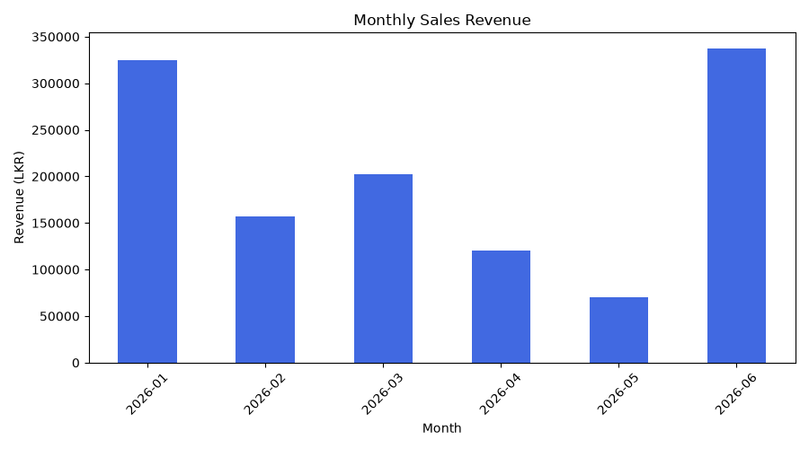
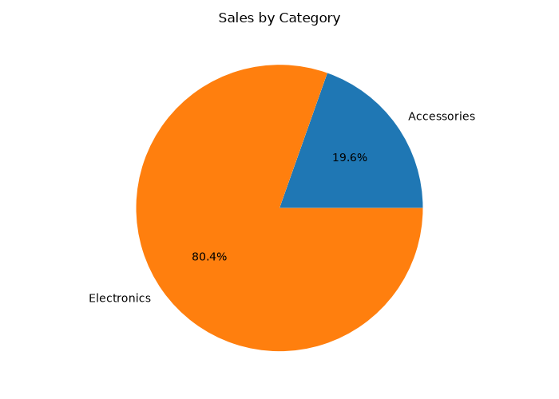
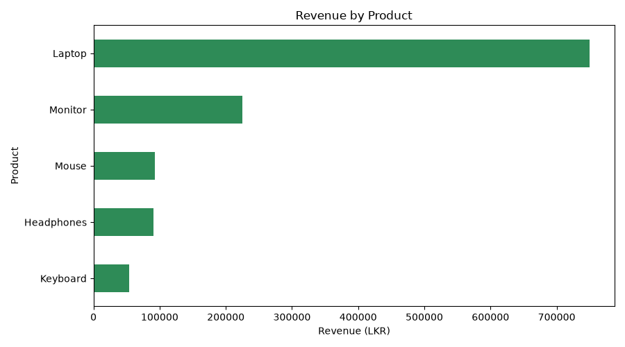

# Sales Data Analysis and Visualization

## Webora Tec – Advanced Python Programming Internship

**Task:** 2 – Data Analysis and Visualization  
**Developer:** Mohamed Raahiq  
**Language:** Python  
**Project Status:** Completed

## Project Overview

This project is a Python-based Sales Data Analysis and Visualization application developed as part of the Webora Tec Advanced Python Programming Internship.

It uses Pandas for data processing and statistical analysis, and Matplotlib for generating visualizations.

The project demonstrates data cleaning, sales performance analysis, and reporting using a synthetic sample sales dataset.

## Technologies Used

- Python 3
- Pandas
- Matplotlib
- CSV
- Visual Studio Code
- GitHub

## Project Features

- Load sales data from a CSV file
- Handle missing and invalid data
- Remove duplicate records
- Calculate total revenue
- Calculate average sales
- Calculate total quantity sold
- Identify the highest sales transaction
- Count total transactions
- Generate three data visualizations
- Identify three key business findings
- Export cleaned data and analysis results to CSV

## Project Structure

    Webora-Sales-Data-Analysis/
    |
    |-- main.py
    |-- sales_data.csv
    |-- cleaned_sales_data.csv
    |-- analysis_results.csv
    |-- category_sales.png
    |-- monthly_sales.png
    |-- product_sales.png
    |-- README.md

## Statistical Analysis Results

| Statistic | Result |
|-----------|--------|
| Total Revenue | LKR 1,212,500.00 |
| Average Sale | LKR 101,041.67 |
| Total Quantity Sold | 73 |
| Highest Transaction | LKR 300,000.00 |
| Total Transactions | 12 |

## Key Findings

1. June 2026 generated the highest monthly sales revenue.
2. Electronics contributed approximately 80.4% of total sales revenue.
3. Laptop generated the highest revenue among all products.

## Data Visualizations

### 1. Monthly Sales Revenue

This bar chart shows monthly sales performance from January to June 2026.



### 2. Sales by Category

This pie chart compares the revenue contribution of Electronics and Accessories.



### 3. Revenue by Product

This horizontal bar chart compares total revenue generated by different products.



## How to Run the Project

### Step 1: Install Python

Install Python 3 on your computer.

### Step 2: Install Required Libraries

Open a terminal and run:

```bash
py -m pip install pandas matplotlib
```

### Step 3: Run the Application

Navigate to the project folder and run:

```bash
py main.py
```

### Step 4: View Results

The program will:

- Display five statistical results
- Display three key findings
- Generate three PNG charts
- Export cleaned sales data
- Export statistical analysis results

## Generated Output Files

- cleaned_sales_data.csv
- analysis_results.csv
- monthly_sales.png
- category_sales.png
- product_sales.png

The PNG charts are generated inside the local `charts` folder when the program runs.

For this GitHub repository, the three PNG files are uploaded to the repository root.

## Dataset Information

The project uses a synthetic sales dataset containing 12 transactions across six months.

The dataset is created for educational and demonstration purposes and does not represent real business transactions.

## Learning Outcomes

Through this project, I gained practical experience in:

- Python programming
- Data cleaning and preprocessing
- Data analysis using Pandas
- Statistical calculations
- Data visualization using Matplotlib
- CSV file handling
- Business data interpretation
- GitHub project documentation

## GitHub Repository

https://github.com/Raahiq33/Webora-Sales-Data-Analysis

## Internship Details

**Organization:** Webora Tec  
**Program:** Advanced Python Programming Internship  
**Task:** 2 – Data Analysis and Visualization  
**Developer:** Mohamed Raahiq

## Conclusion

This project demonstrates how Python can be used to transform raw sales data into meaningful statistical results and visualizations.

It strengthened my practical understanding of data analysis, visualization, and reporting using Python.
